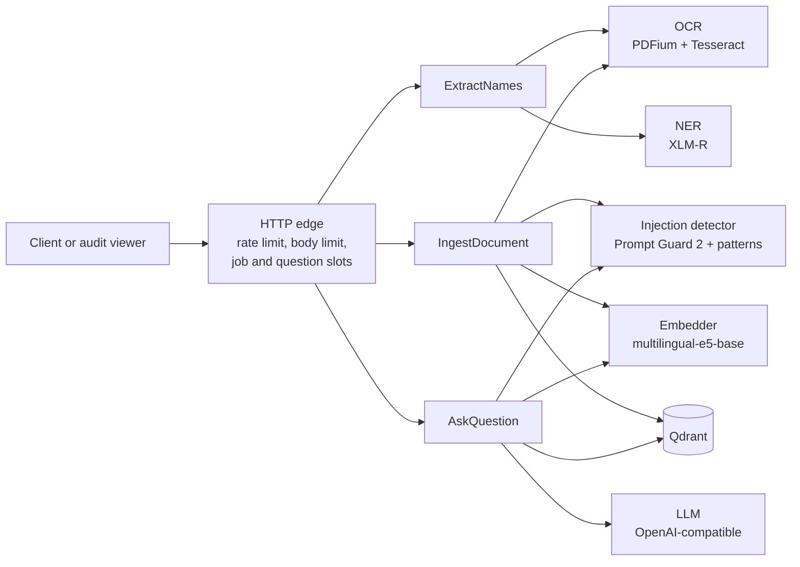
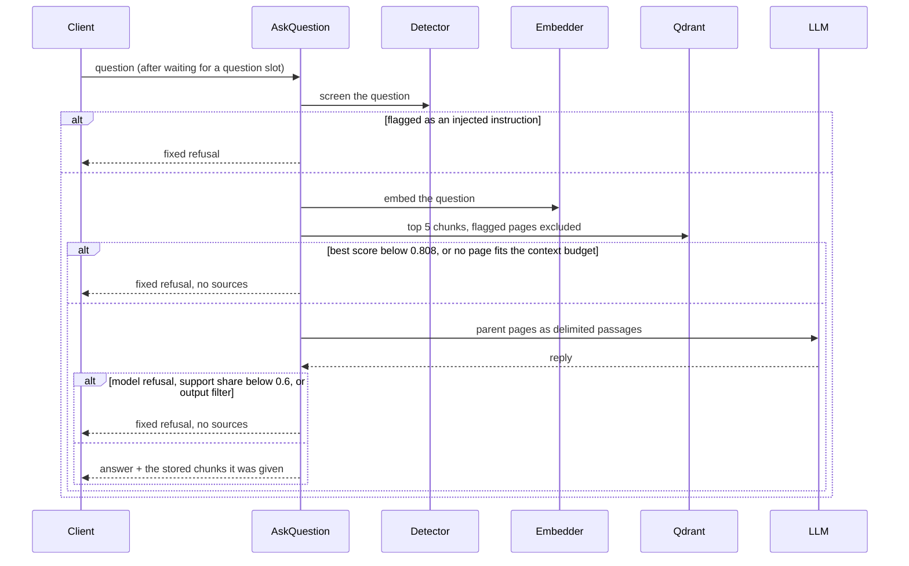

# Design

The service finds every person named in a scanned PDF and returns **where** the name is (page and box in PDF points), so a compliance reviewer can check it. It also answers questions from ingested documents, and only from them, with retrieval-augmented generation (RAG). This page is the summary: the layers and request flows are in [Architecture](docs/architecture.md), each decision with its evidence in [Decisions](DECISIONS.md), and the terms in the [glossary](docs/benchmark-summary.md#glossary).

## 1. Component and sequence view

- **Extraction:** OCR gives words with boxes, converted from pixels to points with the real raster size; a NER model and span rules find the names; their word boxes are united; distinct names are fuzzy-matched.
- **Ingestion:** the document id comes from the SHA-256 of the file, so a stored file is skipped; otherwise each page is read, chunked, screened for injected instructions, embedded and stored.
- **Answering** has the most decisions:

## 2. Technology choices and trade-offs

Models, settings and thresholds were chosen by measurement on a seeded synthetic corpus of 600 scanned documents in five languages ([Benchmarks](docs/benchmark-summary.md)); rows marked *judgement* were not compared. The figures and the rejected options are in [Decisions](DECISIONS.md).

| Concern | Choice | Instead of | Why | Cost accepted |
|---|---|---|---|---|
| PDF rendering | PDFium (`pypdfium2`) | PyMuPDF | PyMuPDF is AGPL-3.0; re-measured, recall unchanged | None measurable |
| Image preprocessing | 200 DPI, illumination flattening | plain rendering, binarisation | Names readable on hard scans: 42.7 % → 90.3 % | A numpy re-implementation of one blur |
| OCR engine | Tesseract 5.5 CLI, one single-threaded process per page | `pytesseract`, a neural OCR | *Judgement:* the suggested engine, no temporary files, pages in parallel | ~0.9 s per page; weak on hard scans |
| NER | `xlm-roberta-base-ner-hrl` + span rules | spaCy, GLiNER, larger models | F1 92.0 end to end against 65.9 for spaCy; multilingual | 1.1 GB model |
| Matching | `rapidfuzz.token_sort_ratio` >= 0.90 | `thefuzz`, other scorers | Whole names in any order; zero false matches on decoys | ~2 points of recall against 0.85; "Jon" matches "John" |
| Embeddings | `multilingual-e5-base` | `sentence-transformers`, larger models | Best same-language retrieval for its cost | Weaker cross-lingual |
| Chunking | 800 characters, 12 % overlap; the LLM gets the parent page | whole-page chunks | Answer in context 81.4 % against 72.2 % | Page text stored per chunk |
| Vector store | Qdrant server, a collection per embedding model | Chroma | *Judgement:* a separate service; vectors of two models never mix | One more container |
| LLM | Any OpenAI-compatible endpoint; Gemma 4 e4b on Ollama | a hosted model | Fastest within the best's interval: 72.3 %, p95 1.8 s; hosted 69.5 % | A GPU for local answers |
| Grounding | Relevance threshold, delimited passages, support share, output filter | the prompt alone | Half of unanswerable questions refused before any model call | 5 % of answerable refused |
| HTTP concurrency | Async FastAPI, worker threads, bounded slots | a job queue | *Judgement,* sizes measured and derived from the CPUs | One process holds every model |

## 3. Scaling to 1,000+ PDFs per hour

**Today**, one container, 16 CPUs, 12 clients, every defence on, documents of about 1.7 pages ([benchmark record](docs/BENCHMARKS.md) section 23):

| Build | `/api/extract` | `/api/ingest` |
|---|---|---|
| CPU | 86 docs/min (~5,200 per hour) | 35 docs/min (~2,100 per hour) |
| CUDA, models on the GPU | 128 docs/min (~7,700 per hour) | 133 docs/min (~8,000 per hour) |

So 1,000 PDFs per hour fit in one container. Extraction needs about 1.8 cores per 1,000 documents per hour; ingestion on the CPU build about 8, because the injection detector dominates it, and on the GPU build OCR is the bound. When each build pays off is in [CPU or GPU](docs/operations.md#cpu-or-gpu).

**For real traffic** (longer documents, bursts, tenants):

1. **Replicas** behind a load balancer: stateless apart from Qdrant; each loads its own models (1.2-3 GB of RAM) and sizes its concurrency from its CPUs.
2. **An asynchronous job API:** `202` with a job id on a durable queue (Redis Streams, SQS), so bursts wait instead of getting 503 and failed jobs are retried.
3. **Separate OCR workers:** OCR is the bottleneck, so it scales on cheap CPU nodes while fewer GPU nodes run the models.
4. **Qdrant as a cluster,** and page text in an object store for long documents.
5. **A production edge** (out of scope by decision): authentication, TLS and quotas at a proxy, a secrets manager, monitoring. The [Security audit](docs/SECURITY.md) covers what is defended without them.

## 4. Failure modes and mitigations

| Failure | What the service does | Residual risk |
|---|---|---|
| Hostile PDF (render bomb, huge images, forged page tree) | Page and pixel budgets before rendering, a render time budget, a text cap per page: `too_large`, `too_many_pages`, `pdf_unreadable` | One huge vector operation (S2) |
| Not a PDF, empty, oversized | Refused before any OCR, by content or declared size: 415, 400, 413 | None known |
| Poor scan | Flattening; low-confidence names dropped; the viewer shows every box | Missed or loose names (O1) |
| Qdrant or the LLM down or slow | Retries with backoff in a deadline; then 503/504 with `Retry-After`; automatic recovery | A full Qdrant volume looks ready (P17) |
| Overload | Bounded slots, then 503 `service_busy`; per-client rate limits (429) | Clients behind one NAT share a bucket (S1) |
| Client disconnects | Extraction and ingestion cancelled at the next step, Tesseract killed | One step finishes first (P5) |
| Hallucinated answer or source | Threshold, support share, output filter; sources are stored chunks | A wrong answer in the context's own words |
| Prompt injection | Pages flagged at ingestion, questions screened; passages delimited as data | Reduced, not eliminated (R3, S3) |
| GPU out of memory | That call fails, the cache is freed, the next call runs | Ollama may unload (P19) |
| Embedding model changed | A new collection is opened; vectors never mix | Re-ingestion needed (R5) |

Codes in parentheses are entries of [Known limitations](docs/KNOWN_LIMITATIONS.md).

## 5. Routing between models by query complexity

Not built; this is how I would add it.

- **Signals before the model call:** top-1 score and its margin over the second, how many documents the chunks come from, context length, question and passage languages, question form ("who", "when" against "why", "compare").
- **Routes:** clear single-passage lookups to the small local model (p95 1.8 s); multi-document, comparative, cross-lingual or low-margin questions to a larger one. A reply that fails the support check is retried once on the larger model. Low-confidence OCR pages can go to a stronger engine the same way.
- **Proof:** replay the 750-question sample (benchmark record section 16) through both routes; adopt the router only if paired accuracy stays within the interval of always using the larger model while cost or latency drops.

## 6. Thresholds on real documents

The relevance (0.808), match (0.90) and injection (0.5) thresholds were set on synthetic documents; on the three real samples some answerable questions score just below 0.808 (KNOWN_LIMITATIONS R1). They are environment settings, so a deployment recalibrates them on its own labelled data without a code change, following the [recalibration procedure](docs/benchmark-summary.md#recalibration-procedure). What to collect, re-measure and try next on real documents, in order of the measured losses and with the privacy cost of each choice, is in [Evolving the solution](docs/evolution.md).
