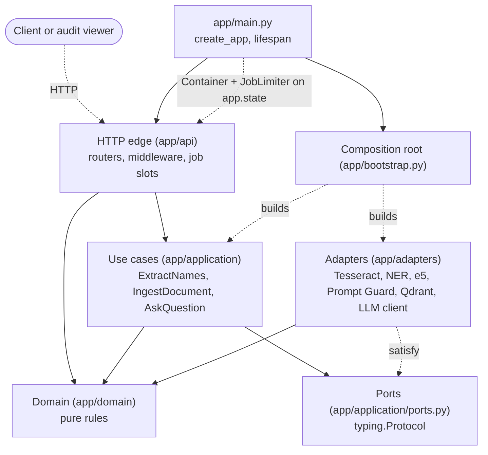
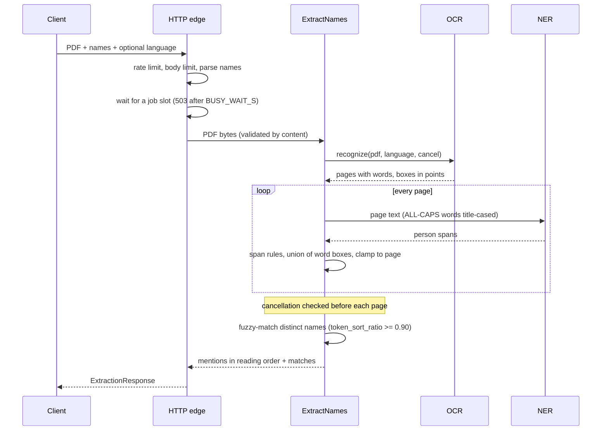
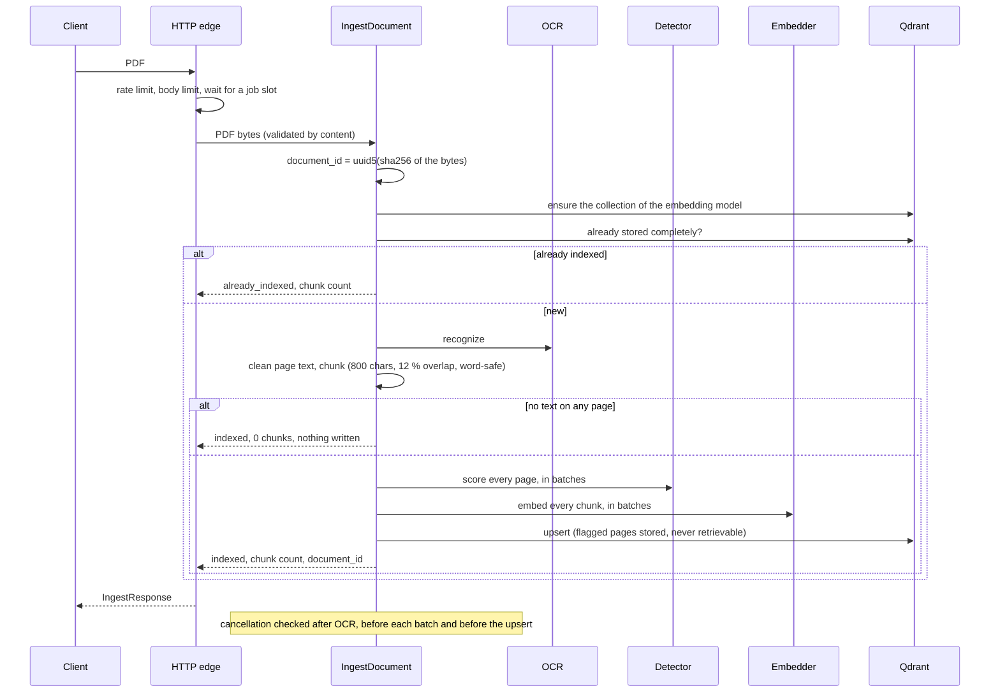
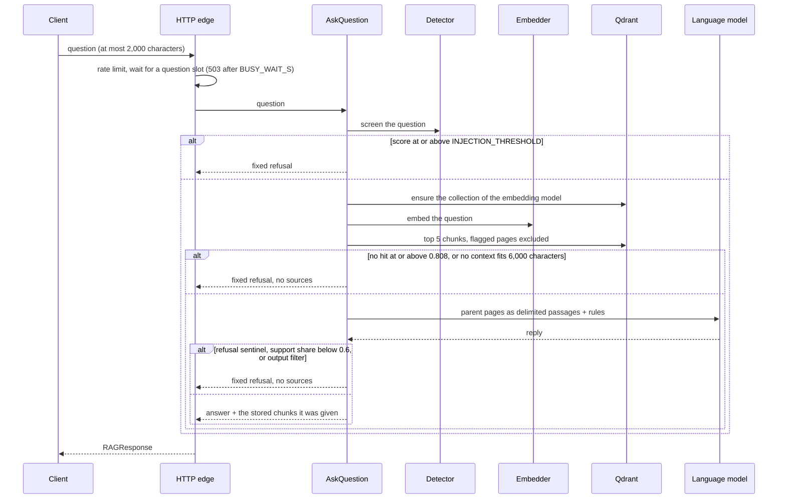

# Architecture

A ports-and-adapters (hexagonal) service in one Python package, `app/`. The core knows nothing about FastAPI, Tesseract, torch or Qdrant; it talks to them through `typing.Protocol` ports, and one composition root wires the real adapters in. Why this shape and not another is in [Design](../DESIGN.md) and [Decisions](../DECISIONS.md).

## Layers



Solid arrows are imports; dotted arrows happen at run time (the lifespan of `app/main.py` builds the container through the composition root and stores it, with the job limiter, on `app.state`, where the routers read it). The adapters never import the ports: they satisfy them structurally, as the test fakes do.

| Layer | Folder | May import | Holds |
|---|---|---|---|
| Domain | `app/domain/` | the standard library and rapidfuzz | Pure rules: page geometry, name span rules, matching, chunking, prompt building, answer guardrails, the error hierarchy. |
| Application | `app/application/` | domain | The ports and the three use cases, plus `PatternDetector` and `CompositeDetector` (the rule-based injection detector and the score combiner) and the stand-ins `NoDetector` and `UnconfiguredLLM`. |
| Adapters | `app/adapters/` | domain and vendor libraries | One adapter per port, each wrapping vendor errors into the core's errors with fixed messages. |
| HTTP edge | `app/api/` | FastAPI, Starlette, Pydantic, AnyIO, the core, `app.models`, `app.settings`, `app.observability`; never an adapter or `app.bootstrap` | Thin routers, one error mapping, middleware, form parsing, the audit viewer's file routes. |
| Composition root | `app/bootstrap.py` | everything | Builds every adapter and use case once from `Settings`; the only module that imports adapters. |

`tests/architecture/test_imports.py` scans the imports of every module and fails if the domain, the application or the HTTP edge imports outside its row, or if any module but `app/bootstrap.py` imports an adapter, so the layering cannot erode silently. The adapters' row is a convention the code follows, not a rule the test checks.

## Components

| Component | Port | Adapter and model | Notes |
|---|---|---|---|
| OCR | `OcrEngine` | `TesseractOcrEngine`: PDFium renders each page at 200 DPI, illumination flattening, the Tesseract CLI per page | Pages in parallel (single-threaded processes), language detected from the first pages, boxes converted to points from the real raster size. |
| Names | `NameRecognizer` | `TransformersNameRecognizer`: `Davlan/xlm-roberta-base-ner-hrl` | A pool of pipelines sharing one model; the span rules live in the domain. |
| Embeddings | `Embedder` | `E5Embedder`: `intfloat/multilingual-e5-base` | One model, a pool of passage slots plus one reserved for questions. |
| Vector store | `VectorStore` | `QdrantVectorStore` | One collection per embedding identity; deterministic point ids; idempotent upsert. |
| Injection detection | `InjectionDetector` | `PromptGuardDetector` when `INJECTION_MODEL_PATH` is set, else the application's `NoDetector` | With `INJECTION_PATTERNS` on (the default) the composition root wraps either with `PatternDetector` in a `CompositeDetector`, which keeps the higher score. |
| Language model | `LLMClient` | `OpenAICompatibleClient` (httpx) | Retries with backoff, `Retry-After`, an overall deadline. |

## Request flows

### `POST /api/extract`



### `POST /api/ingest`



Every score and vector is computed before anything is written, so a failing model stores nothing, and a cancelled request never leaves a partly stored document.

### `POST /api/ask`



## Concurrency and resources

- **Async edge, blocking work in threads.** Handlers are `async`; each use case call runs in a worker thread of a dedicated AnyIO limiter (`app/api/dependencies.py`), so a request waiting for a slot holds no thread. Inside a job, the OCR engine runs its own pool of `OCR_WORKERS` threads, each waiting on one Tesseract process, so one job uses 1 + `OCR_WORKERS` threads.
- **Slots.** Extraction and ingestion share `MAX_CONCURRENT_JOBS` slots; questions have their own `MAX_CONCURRENT_QUESTIONS`; readiness checks have their own threads. A request that cannot start within `BUSY_WAIT_S` gets 503 `service_busy` with `Retry-After`.
- **Per-client limits.** Before any of that, the rate limiter gives each client address a token bucket per route class (uploads, questions) and caps the jobs one address may hold (`MAX_JOBS_PER_CLIENT`, uploads only); over a limit the answer is 429 `rate_limited`.
- **Cancellation.** A client disconnect cancels its extraction or ingestion: Tesseract processes are terminated and the use case stops at its next check. A question is not cancelled; it runs to its end.
- **Model pools.** NER pipelines, embedder slots and detector slots are handed out in arrival order (`FifoSlots`), with a slot reserved for questions in the embedder and the detector.
- **Sizes derived from the CPUs.** Unset, the job limit and the pools are derived from the CPUs available to the container (affinity and cgroup quota) and logged once at start-up. [Configuration](configuration.md) has the rule.

## Middleware

In `app/main.py`, outermost first: `RequestContextMiddleware` (request id, access line, a 500 for any unexpected exception, protective headers on API responses), `RateLimitMiddleware` (per-client buckets and job cap, 429 before the body is read), `BodyLimitMiddleware` (413 for a body over the route's limit), then FastAPI's exception handlers and the routers.

## Errors and observability

- **One error hierarchy** (`app/domain/errors.py`): every failure has a stable `code` and a category; adapters raise only these, with fixed messages that never repeat input or secrets. `app/api/errors.py` maps each code to one status. Every error body is `{"detail", "code", "request_id"}`. [HTTP API](api.md) lists the codes.
- **Logs** (`app/observability.py`): one JSON line per event with the request id, one access line per request and one outcome line per use case (counts, ids, durations). Only allow-listed fields are written and exception messages are redacted, because documents carry personal data.
- **Probes.** `/health` never touches a dependency; `/health/ready` pings Qdrant within `READINESS_TIMEOUT_S` and reports whether a model is configured.

## Where the code is

```
app/domain/        pure logic (stdlib + rapidfuzz)
app/application/   ports and use cases
app/adapters/      OCR, NER, embeddings, injection, vector store, LLM, device helpers
app/api/           routers, middleware, errors, rate limit, uploads, viewer routes
app/web/           the audit viewer (HTML, ES modules, CSS)
app/bootstrap.py   composition root
app/main.py        create_app(): routers, handlers, middleware, lifespan
app/settings.py    every tunable, from the environment
app/observability.py   JSON or text logs on stdout with the request id, redacted
app/llm_warmup.py  the compose start-up check that loads the local model before the service starts
app/models/schemas.py   the fixed API contract
tests/             unit, contract, HTTP, integration, adversarial, deploy and browser tests
openspec/          living specs and the archived changes with their designs
deploy/, scripts/  the pdf.js pin, its fetcher, the model-hash resolver, the docs server
```
